<h1 align="center">Assistive Vision Glasses</h1>

<p align="center">
  Smart-glasses MVP that helps blind and visually impaired people walk around obstacles —<br>
  an ESP32-S3 camera + ultrasonic sensor on the glasses, YOLO-based scene understanding on a laptop,<br>
  and short spoken instructions plus left / right buzzer cues back to the user.
</p>

<p align="center">
  <a href="https://github.com/ax1le28/zakassomsarobotics/actions/workflows/ci.yml"></a>
  
  
  
  
  
</p>

<p align="center">
  
</p>

## How it works

1. **Glasses (ESP32-S3).** A thin client captures a JPEG frame, reads the HC-SR04 ultrasonic distance and sends both to `POST /analyze`.
2. **Backend (laptop, FastAPI).** Local YOLO detects objects, distance is estimated from bounding-box geometry and fused with the ultrasonic reading, and the navigator scores left / center / right risk to pick a command.
3. **Feedback.** The backend speaks a short instruction (ElevenLabs, or macOS `say` as a fallback) and the ESP32 drives two buzzers with a matching pattern.

The ESP32 is intentionally kept simple: it only captures, senses and sends. All AI runs on the laptop.

## Features

- **Obstacle detection** with local YOLO (`yolo11n.pt` by default), plus scripts to fine-tune it on home and office scenes.
- **Distance fusion** — bbox height, object class and vertical position, fused with ultrasonic distance for center-path obstacles.
- **Navigation logic** — walking-corridor overlap, left / center / right risk scores, object relevance, bbox size and confidence.
- **Calm guidance** — temporal distance smoothing, command stability frames against flicker, and throttled repeat messages.
- **Scene-aware labels** — separate home and office label sets; small items (keyboard, phone, cables…) stay low priority unless close or in the corridor.
- **Structural hazards** — stairs and steps trigger a dedicated stop instruction; a center-path *wall* fallback kicks in when ultrasonic sees an obstacle that vision misses.
- **Buzzer patterns** — `CLEAR`, `LEFT`, `RIGHT`, `STOP` (slow pulse), `DANGER` (fast pulse).
- **CI** — GitHub Actions compiles the Python code and builds firmware for both supported boards.

## Hardware

| Part | Notes |
| --- | --- |
| ESP32-S3 camera board | Freenove ESP32-S3 WROOM or Seeed XIAO ESP32S3 Sense |
| HC-SR04 ultrasonic sensor | Echo is 5 V — use a voltage divider or level shifter to 3.3 V |
| 2 × buzzer | Left / right, default GPIO 41 and 42 |
| Laptop | Runs the backend and text-to-speech |

Do not reuse camera pins from `camera_pins.h` (on the Freenove board, GPIO 6 and 7 belong to the camera).

## Quick start

### Backend

```bash
git clone https://github.com/ax1le28/zakassomsarobotics.git
cd zakassomsarobotics
python3 -m venv .venv
source .venv/bin/activate
pip install -r requirements.txt
cp .env.example .env
uvicorn main:app --host 0.0.0.0 --port 8000
```

On first run, `ultralytics` downloads `yolo11n.pt`.

### Firmware

```bash
cp firmware/platformio_esp32_camera_client/src/wifi_config.example.h \
   firmware/platformio_esp32_camera_client/src/wifi_config.h
```

Edit `wifi_config.h` with your Wi-Fi credentials, the backend URL (`http://<laptop-ip>:8000/analyze`) and the sensor / buzzer pins, then build and flash with PlatformIO:

```bash
pio run -d firmware/platformio_esp32_camera_client -e freenove_esp32_s3_wroom -t upload
```

Available environments: `freenove_esp32_s3_wroom`, `seeed_xiao_esp32s3_sense`. `wifi_config.h` is git-ignored so credentials never get committed.

### No hardware? Use the webcam

```bash
python webcam_debug.py
```

| Key | Action |
| --- | --- |
| `Q` / `Esc` | quit |
| `+` / `-` | increase / decrease simulated ultrasonic distance |
| `0` | reset simulated distance to 5.0 m |

Test speech on its own:

```bash
python3 scripts/speak_output.py "Chair one meter ahead, go left"
```

## API

`POST /analyze`

```json
{ "distance": 1.2, "image": "<base64 jpeg>", "speak": true }
```

Response (shortened):

```json
{
  "command": "RIGHT",
  "message": "Chair 1.2 meters ahead, go right",
  "obstacle": "chair",
  "distance": 1.2,
  "detections": [
    { "label": "chair", "confidence": 0.83, "distance": 1.2, "position": "center",
      "bbox": [120, 180, 500, 700], "action": "RIGHT", "source": "yolo" }
  ],
  "reason": "left/center risk is higher; right side is safer",
  "zones": { "left": 3.2, "center": 0.6, "right": 0.1 }
}
```

`bbox` is normalized to `0..1000` as `[x1, y1, x2, y2]`.

## Configuration

All tuning lives in `.env` (see `.env.example`). The most useful knobs:

| Variable | Default | Purpose |
| --- | --- | --- |
| `CAMERA_VERTICAL_FOV_DEG` | `55` | camera field of view used for distance estimation |
| `DISTANCE_SCALE` | `1.0` | lower (≈0.8) if distances read too far, raise (≈1.2) if too close |
| `DISTANCE_SMOOTHING_ALPHA` | `0.45` | temporal smoothing of distance |
| `TTS_REPEAT_SECONDS` | `5.0` | minimum gap between repeated messages |
| `TTS_DANGER_REPEAT_SECONDS` | `1.5` | repeat gap for danger messages |
| `ELEVENLABS_API_KEY` | *(empty)* | enables ElevenLabs voice; otherwise macOS `say` |

## Fine-tuning for home & office

The base COCO model misses things like walls, doorways and stairs. `training/` contains the dataset config and a step-by-step guide:

```bash
python scripts/collect_frames.py --out datasets/home_office/raw --every 1.0
# annotate in YOLO format (Label Studio, Roboflow, CVAT or LabelImg)
python scripts/train_home_office.py --data training/home_office_dataset.yaml --base yolo11n.pt --epochs 80 --imgsz 640
```

Then point `YOLO_MODEL` in `.env` at `runs/detect/home_office_yolo/weights/best.pt`. More detail in [`training/README.md`](training/README.md) and [`TRAINING_GUIDE.md`](TRAINING_GUIDE.md).

## Project structure

```text
main.py            FastAPI entrypoint (/analyze)
detector.py        local YOLO object detection
navigator.py       risk scoring and command decisions
speaker.py         text-to-speech output
schemas.py         request / response models
image_utils.py     base64 image helpers
webcam_debug.py    laptop-camera test client
scripts/           data collection, auto-labelling, training, TTS tests
training/          home / office dataset config and notes
firmware/          PlatformIO ESP32-S3 camera client
```
